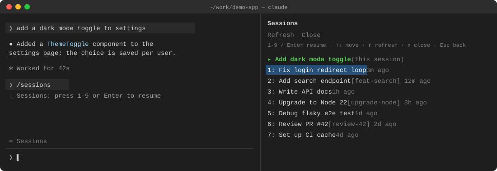
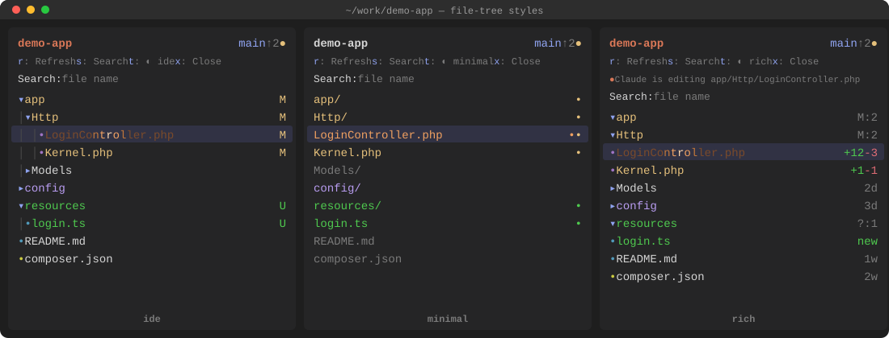

# cc-mods

Small Claude Code mods: function-hook plugins that add panes, bands and commands inside Claude Code.

## Mods

### session-switcher

A sidebar listing the current project's sessions. Pick one to resume it.



- `☰ Sessions (12)` above the prompt, or `/sessions`, opens the pane with the keyboard on it
- The pane's header counts the sessions, or the matches while searching (`3 / 12`)
- `1`–`9` or `Enter` resumes a session, `r` refreshes, `x` closes, `Esc` goes back to the prompt
- `s` jumps to the search field: typing filters the list by session name or worktree (case and diacritics ignored, so `y tuong` finds `Ý tưởng`), `Enter` resumes the first match
- `/sessions close` hides the pane from the prompt
- Sessions from the project's git worktrees are listed too, tagged with the worktree's name in cyan (`[feat-search] 12m ago`, lined up at the right edge)
- A session is titled by its custom title, its AI title, or its first typed prompt; one with none of them is left out
- The open session is marked `▸ (this session)`

### file-tree

An IDE-style file tree beside the conversation, showing what Claude reads, edits and commits.



- `▤ Files` above the prompt, or `/tree`, opens the pane (`/tree close` hides it); it docks beside the transcript in the fullscreen layout (`"tui": "fullscreen"` in settings, a terminal 110+ columns wide), else above the prompt
- Click the tree once, then `↑`/`↓` move, `→` opens a folder, `←` closes it, `Enter` or a double-click previews a file
- Files Claude reads light up purple, edits orange, commits green; folders open to them
- Git status per file and folder, `+N -N` line counts, branch and ahead/behind in the header
- `s` searches every file, opened folders or not (case and diacritics ignored)
- `t` cycles three styles: `ide`, `minimal`, `rich`
- The preview draws Markdown or highlighted code; `↗` opens the file with your **Open with** command (`code -g {path}`, `phpstorm {path}`) or the default app
- Settings in `/config` → file-tree: Style, Preview layout (`replace` or `split`), Open with, Follow Claude, Icons (`nerd` or `unicode`), Show ignored files

## Install

```
/plugin install session-switcher --marketplace ha-ptt0601/cc-mods
/plugin install file-tree --marketplace ha-ptt0601/cc-mods
```

Answer `y` to add the marketplace, then pick the user scope.

## Develop

Run a mod straight from its folder, reloading on save:

```
claude --plugin-dir ./file-tree     # or ./session-switcher
```

Check it:

```
claude plugin validate ./file-tree
claude plugin test ./file-tree
```
